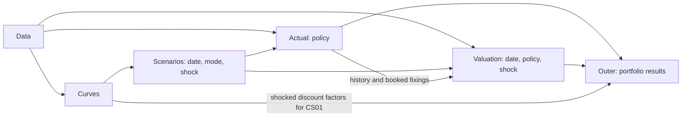

# Shared MYGA DV01 and CS01 model

Create a live model with `build_model(route="collect")` or
`build_model(route="direct")`. `results(model)` returns base liability values,
DV01, CS01, base valuation cash flows, Actual cash flows and annual state
snapshots. Close the model after use.

`Data` owns the policy and assumption tables and the annual market inputs.
`Curves` owns monthly interpolation, prepared node discount factors, base
zero yields and discount factors. Its keys describe the curve observation,
annual or monthly input selection, maturity and shock. Base curve preparation
and base yields are shared across shocks.

`Scenarios(valuation_month, forward_project, shock)` delegates market
calculations to `Curves`. All policies at the same valuation date and shock
use the same Scenario ItemSpace by default. Actual runs the saved MYGA
calculations at policy months counted from issue. Valuation uses that same
clock for the saved MYGA Cells. At a restart it reads the policy's observed
history and booked rates from Actual. The reporting Cells convert a month
offset into a policy month once.

Curve calculations use the original annual-effective rates, piecewise-flat
forward interpolation, end extrapolation and triangular key-rate shocks.
CS01 uses the shared discount factors with the base cash flows. Curve
customizations can be made through the `Curves` Cell formulas. An item-level
Valuation market override applies to that item's prospective rates and
discounting. The initial declared credit rate and the MVA reference fixing
come from the issued policy record.

Data is the converted MYGA_US_S Data Space (its table Cells read the CSV files) with
the DV01 lookup Cells written as plain table reads, as the MYGA Projection reads the
same tables: `.loc` by key, a missing withdrawal or surrender key is zero, the MVA
factor is interpolated between whole years and held beyond the last row. The
shared readers cache each assumption table as it is used.

The default inputs are the CSV files in the parent product directory.
`reference_dir` selects another input directory, and `policy_table` supplies
an alternative policy DataFrame indexed by `point_id`. The source reference
pins are recorded in `provenance.json`.

Pass `myga_model=path_to_saved_MYGA_US_S` to use the saved MYGA model's Data
Cells. DV01 uses those Cells for policy rows and assumption tables and uses the
saved Projection Cells for the underlying actuarial calculations. DV01 supplies
its market roles, observed Actual history, and valuation and shock orchestration.
`reference_dir` can select the CSV directory for those Cells. With this option,
the policy book comes from the MYGA model point Cell.

Export with `model.export(path, locked_spaces=['Scenarios'])` and use the
ordinary modelx-cython sample tracing workflow. The compiler discovers types
through the sample run. The lock protects shared Scenario calculations while
policy items in Actual and Valuation remain independently eligible for collect.

## Model structure



| Space | Cells and inputs it owns |
| --- | --- |
| Data | Saved MYGA policy, mortality, surrender, withdrawal and MVA assumptions. The example sets ten annual observations of a seven-tenor zero curve and the crediting spread. |
| Curves | Monthly observations, node discounts, zero yields, key-rate weights, shocked discount factors, forward yields and the portfolio discount-factor vector. |
| Scenarios | A shared market identified by valuation month, observed/forward mode and shock. Exposes the curve, spread, quoted rate and end-of-month discount factor. |
| Actual | Saved MYGA policy Cells, observed market, issue and renewal fixings, cash flows and history at restart dates. |
| Valuation | Saved MYGA policy Cells, restart boundary, one selected market, prospective quotes, cash flows by reporting offset, and liability PV. |
| Outer | Book-level Actual cash flows and policy state snapshots, base cash flows and liability PV, DV01 and CS01. |

### One policy, two clocks

```python
v = model.Valuation(12, 7, 3)
assert v.market() is model.Scenarios(12, True, 3)
assert v.market() is model.Valuation(12, 8, 3).market()
v.net_cf(18)              # MYGA cash flow at month 18 from issue
v.cashflow_at_offset(6)   # same cash flow, six months from valuation
```

The earlier nested example used `v.net_cf(6)` for that reporting call. Use
`cashflow_at_offset(6)` when migrating a relative cash-flow query.
The portfolio cash-flow series still starts at offset zero. Its 480 entries
include zeros after expiry. Query the MYGA Cells directly on Valuation.

### Follow the market into a cash flow

1. **Observe the market.** The ten annual curves are flat across tenors at
   1%, 2%, through 10%. The annual crediting spread rises from 0.50% to
   1.50%. Actual uses monthly linear interpolation in calendar time. At
   month six the observed curve is 1.50% at each tenor. Observations beyond
   the final annual point use the final curve and spread.
2. **Build the term structure.** At each tenor `T`, a zero yield `z`
   gives `DF(T) = (1 + z) ** -T`. Interpolate log discount factors between
   nodes. Before the first node use its yield. Beyond 20 years extend the
   last forward rate. The seven tenors are 1, 2, 3, 5, 10, 15 and 20 years.
3. **Select a scenario.** Actual reads the observed path. Valuation selects
   the annual observation for its date, holds that observation's spread and
   uses implied forwards for future quotes. For a positive tenor `T`, the
   forward rate starting at year `s` is `(DF(s) / DF(s + T)) ** (1/T) - 1`.
   A key-rate shock adds one basis point times a triangular weight to the
   zero yield before computing those discount factors. The first and last
   shocks hold full weight beyond the corresponding end node.
4. **Apply the policy terms.** The competitor tenor follows remaining
   guarantee duration, or one year after the initial annual-redeclaration
   term. The renewal quote uses one year for annual redeclaration and five
   years otherwise. Future credited rates use the greater of the contractual
   floor and the renewal quote less the crediting spread. A current MVA
   reference quote uses the contract's MVA term and a new MVA fixing uses
   five years. Issue rates come from the policy record. Fixings already
   booked at the restart date come from Actual history.
5. **Calculate policy behavior and payments.** Credited and competitor rates
   feed the saved MYGA dynamic lapse formula. The saved MVA formula applies
   the policy's linear-duration, geometric or declared-differential rule
   and its contractual caps. These feed withdrawals, surrender and other
   benefits. MYGA net cash flow equals premiums less withdrawals, claims,
   commissions, expenses and premium taxes.
6. **Discount and collect.** A payment at reporting offset `k` uses the
   selected market's discount factor to `(k + 1)/12` years. The liability
   is the negative sum of discounted net cash flows. DV01 reprojects cash
   flows under each shock. CS01 rediscounts aggregate base cash flows.

For example, at month 12 the default five-year zero rate is 2.00%. Shock
index 3 moves it to 2.01%. The five-year discount factor moves from
0.905731 to 0.905287. An issued rate already booked for the policy carries
forward. The shock affects a future fixing when the contract requests it.

```python
base = model.Valuation.collect(12, -1).sum.liability_pv
shocked = model.Valuation.collect(12, 3).sum.liability_pv
dv01 = base - shocked
```

On the corrected seven-policy reference book, the month-12 base liability
is 758,741.69. Reprojecting with the five-year shock gives 758,586.22,
so DV01 is 155.47. Rediscounting the base cash flows instead gives
758,551.05, so CS01 is 190.64. These reference amounts are rounded after
the calculation.

The shipped run uses one Actual projection and eight Valuations (base and
seven shocks) at each of months 0, 12 and 24, for 25 projections per policy.
See [market selection](scenario.py), [curve formulas](curves.py),
[observed calculations](actual.py), [restart and valuation](valuation.py),
[model construction and reporting](model.py) and
[the saved MYGA policy formulas](../MYGA_US_S/Projection/__init__.py).

## Checking results

A book made of k copies of the seven reference policies must give k times the
seven-policy results. Each element may differ by

    1e-10 x (the sum of the magnitudes that went into the value) + 1e-7

For a plain sum, that sum of magnitudes is |value|. DV01 and CS01 are a base
present value minus a shocked present value, both totals over the book. Their
sum of magnitudes is |base PV| + |shocked PV|, because the difference is much
smaller than either term and inherits the rounding of both.
